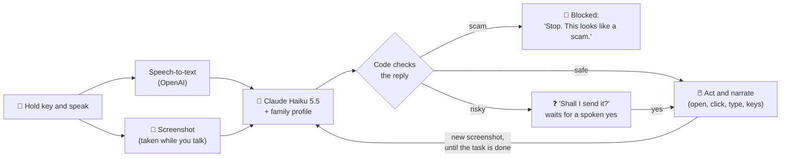

# Accex

**An AI digital navigator for people who never learned to use a computer.**

Hold a key and ask out loud, in your own words. Accex looks at your screen, does the task step by step and tells you what it's doing.

Built for Cutie Hack 2026 (Social Impact + AI tracks).

## Who it's for

People who are digitally illiterate: older adults, workers who never needed a computer, and anyone locked out of online services because nobody taught them. No computer words and no mouse skills needed.

Most older adults say they would need someone's help to learn a new device ([Pew](https://www.pewresearch.org/internet/2014/04/03/attitudes-impacts-and-barriers-to-adoption/)), and Americans over 60 reported $7.7 billion in losses to internet crime in 2025 ([FBI IC3, via AARP](https://www.aarp.org/money/scams-fraud/fbi-ftc-report-2025-losses/)).

## What sets it apart

- **It understands vague requests.** "I want to see my grandson's email" works, because Accex uses a profile of the user's family (`family.json`) and learns new names and nicknames as it goes.
- **It finishes the job and narrates every step.** Accex acts, looks at the screen again and continues until the task is done, saying what it does, so it's never a black box.
- **It asks before anything risky.** It needs a spoken "yes" before sending, deleting or buying anything, and that rule is enforced in code, not left to the model.
- **It stops scams.** Every screen is checked for scams (fake virus warnings, gift-card requests, remote-access programs, "relatives" asking for money), and they are blocked before anything is clicked.

**In the demo:** "Play Bohemian Rhapsody on Spotify" becomes four real actions, narrated, ending with the song playing, with nobody touching the mouse. Then a fake "your grandson needs gift cards" email appears, and Accex refuses: *"Stop. This looks like a scam."*

## Setup (Windows 11, Python 3.12 or 3.13)

```powershell
python -m venv .venv
.venv\Scripts\activate               # if blocked: Set-ExecutionPolicy -Scope Process -ExecutionPolicy Bypass
pip install -r requirements.txt
copy .env.example .env               # then add your API keys
copy family.example.json family.json # the user's family profile
```

Turn on **Settings → Privacy & security → Microphone → Let desktop apps access your microphone**, and set `ACCEX_PROFILE=senior` in `.env`.

## Run

```powershell
python main.py --mock all              # no keys needed: type questions, read the spoken answers
python main.py --ui                    # everything real, with the floating glass pill
python -m ui.preview                   # design preview of the pill (no API)
python main.py --demo --dry-run        # print every event; log actions instead of running them
pytest                                 # 231 tests, mocks only
```

Hold **Right Ctrl** (`ACCEX_HOTKEY`) to talk and release it to send. Pressing it again stops Accex at once.

## How it works



Every step is spoken out loud, and the glass pill shows what Accex hears, says and does.

## Layout

| Path | What |
|---|---|
| `interfaces.py` | Shared data types and protocols |
| `main.py` | Orchestration loop, multi-step tasks, profiles, real/mock wiring |
| `voice/` | Push-to-talk, recording, STT, TTS (SAPI, OpenAI, ElevenLabs), earcons |
| `brain/` | Screen capture, vision LLM, prompt, memory, family profile, scam guard, evals |
| `actions/` | Action registry, executor, spoken confirmation |
| `ui/` | Floating glass pill (pywebview), opt-in with `--ui` |
| `demo/` | Event log, latency report, demo checklist |
| `mocks/` | Fakes for every package |


## Privacy

- **Nothing on disk:** screenshots and audio stay in memory and are never written to disk. Logs are text only.
- **Screen text is data:** text on the screen is never followed as instructions.
- **The pill stays out of the way:** it is click-through and excluded from Accex's own screenshots.
- **Private files stay private:** API keys (`.env`) and the family profile (`family.json`) are never committed.

## Limitations

Windows only, needs internet, and English speech only for now. Scam detection is a strong safety net, not a guarantee.

## Team

Raúl Palomo (voice) · Piuvi (brain) · Adrián (actions, demo, UI) · [Name] ([role])